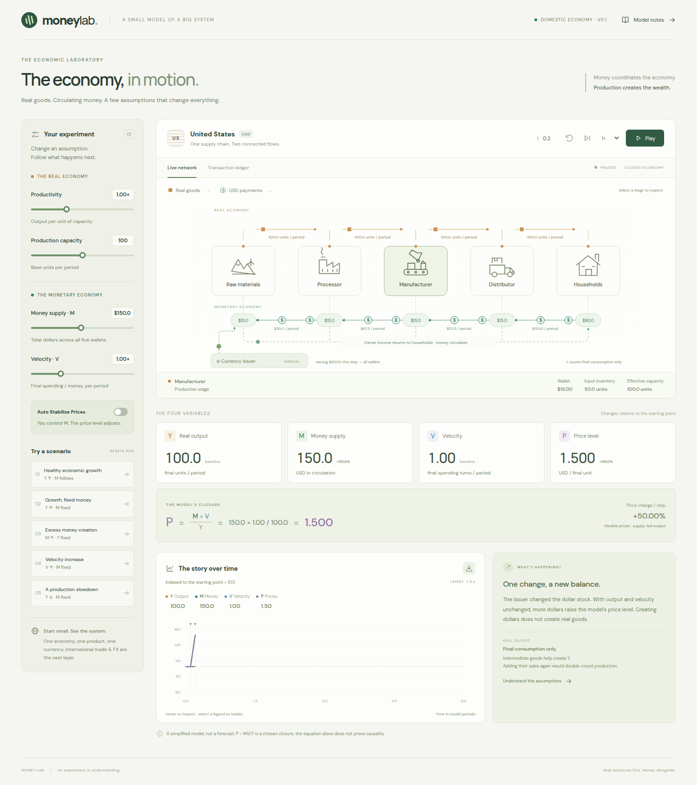

# Money Lab

**A deterministic, interactive laboratory for monetary economics. Goods flow down a supply chain, money flows back, and the price level follows P = MV / Y.**



**Highlights**
- A pure TypeScript simulation engine (immutable state transitions with tested money conservation), separated from the React/SVG UI.
- Five repeatable scenarios (healthy growth, fixed money, excess money, velocity shock, production slowdown) plus a CSV export.
- Economic invariants are unit-tested, and desktop and mobile interaction are tested with Playwright.
- Multi-agent workflow: built with OpenAI Codex, with Claude Code reviewing the architecture and the final build. The full reviews are in [`reviews/`](reviews/).

**Stack:** React, TypeScript, Vite, SVG, node:test (via tsx) and Playwright.

---

An interactive, deterministic monetary-economy laboratory built with React, TypeScript, Vite, and SVG. This first delivery implements the **one-country USA/USD MVP** from the requested development sequence. International USD settlement, Europe, India, and FX are subsequent phases; they are not simulated or presented as working controls.

## Run

```sh
npm ci
npm run dev
```

Vite prints the local URL. Production: `npm run build`, then `npm run preview`.

```sh
npm test               # Economic invariants and numerical scenarios
npm run test:browser   # Desktop/mobile interaction checks
```

Browser tests use local Google Chrome if available, or Playwright Chromium (`npx playwright install chromium`). Set `PLAYWRIGHT_CHROMIUM_EXECUTABLE` to use another local Chromium binary.

## Explore

- Play/pause, single-step, speed, and reset.
- Change productivity, capacity, velocity, and the price target. Disable Auto Stabilize to control M directly.
- Releasing a slider or committing a field executes one complete step, including when paused.
- Select a supply-chain stage to inspect its wallet, inventory, and capacity.
- Inspect actual matched goods/payments, issuance, and owner income in the transaction ledger.
- Run five independent scenarios: healthy growth, growth with fixed M, excess money, velocity increase, and a production slowdown.
- Inspect indexed time series with exact-value hover readouts and export the retained history as CSV.
- Open Model notes for equations, step order, and limits.

## Model

One period is a normalized time unit, not a year. A step is 0.1 period. Baseline M=100, V=1, Y=100, P=1.

- **Y**: final units consumed per period. A synchronized, pull-based, 1:1 chain is limited by physical capacity/productivity and opening input inventory. Input buffers are replenished each step. All final production is consumed. Intermediate sales and inventory investment are excluded.
- **M**: sum of all five USD wallets. Households initially hold 60%, each firm 10%. Ordinary sales and owner-income transfers conserve M. Only explicit issuer entries change it.
- **V**: assumed final-spending velocity per period. It does not include intermediate payments or owner-income transfers.
- **P=MV/Y**: supply-led, flexible-price closure from the spending rule E=MV. It is an explicit modeling assumption, not proof of monetary causation. With zero final output P is undefined and the issuer holds M constant.
- **Auto Stabilize**: target M = target P × Y / V; the issuer closes 20% of the gap each step. Transient deviations from the target are intentional.
- Intermediate prices are 20%, 45%, and 75% of the final price. Margins of 20%, 25%, 30%, and 25% return to households as owner income. Sum of value added equals final sales. There are no wages, employment, credit, taxes, banks, or interest rates in this MVP.
- Final household spending is at most 30% of M per step within the allowed velocity range, below the household's 60% wallet share. Downstream payments finance upstream purchases. Same-step income return closes the loop. No money is created to finance transactions.
- Control changes and scenario shocks are marked in the chart. Baseline is always index100. The latest240 samples are retained. Inflation is displayed as the percentage price change from the previous step, with no annualization.

The engine uses normalized floating-point quantities, with conservation tested to a numerical tolerance. Starting inventory is an assumed physical endowment. Inventory buffers remain constant in this synchronized model; inventory investment, delays, and cash-constrained production would require a richer model.

## Structure and extension

`src/simulation/` contains pure TypeScript state and accounting, without React or browser clocks:

- `types.ts`: Country, EconomicNode, Inventory, Currency, Wallet, Transaction, FXMarket, CurrencyIssuer, Scenario, and SimulationState.
- `agent.ts`, `economy.ts`: baseline nodes and country.
- `supplyChain.ts`: physically feasible production and material transfers.
- `currency.ts`: explicit proportional currency creation/removal.
- `transactions.ts`: conserved payments and owner-income return.
- `simulationEngine.ts`: immutable discrete transitions, control updates, and history.
- `scenario.ts`: repeatable parameter experiments.

`src/components/` renders the engine snapshots. UI clock speed and SVG animation state are separate from economic time. Tokens summarize direction and relative activity; they are not individual ledger entries or literal dollars. Reduced-motion mode retains static goods/payment symbols.

The schema includes country/currency identifiers, multi-currency wallets, chain IDs, and a separate FX market collection. Next stages should extract the current country step into a per-country transition, add additional product definitions, and implement international settlement as a distinct ledger phase. Foreign USD holdings must remain part of total USD supply, but international transactions must never be added to US final output. Domestic circulating USD and foreign held USD need separate definitions before applying a domestic price closure.

## Claude consultation

Claude Code reviewed both the architecture and the final implementation, then verified the corrections in a follow-up review. The complete responses are in `reviews/`. Adopted suggestions include the explicit household income loop, distinction between final-spending velocity and all payments, value-added reconciliation, lagging issuer explanation, zero-output handling, accessible static animation alternatives, and accounting tests. Pipeline delays and working-capital models were deferred to preserve the requested MVP's transparent numerical examples.

The final review found the accounting coherent. Its UI findings were addressed: zero-output payment labels, one commit per slider drag, editable price targets, auto-mode velocity explanations, unique transaction IDs, explicit baseline labeling, out-of-range money hints, and keyboard/focus handling. The correction check reported no remaining substantive defects; its three minor follow-ups (manual-range hints, Safari focus restoration, and pointer capture) were also addressed. See `reviews/claude-correction-check.txt`.
